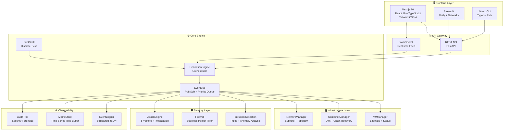
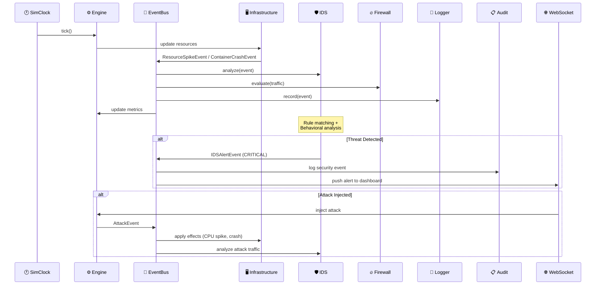
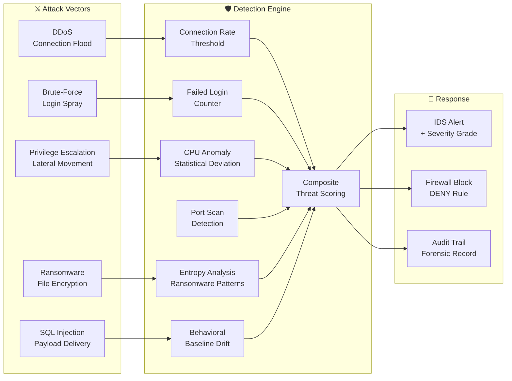

<p align="center">
  
</p>

<h1 align="center">☁️🛡️ Nimbus Threat Range</h1>

<p align="center">
  <strong>A production-grade, event-driven cloud infrastructure and cybersecurity simulation platform.</strong><br>
  <em>Real-time attack injection, intrusion detection, threat visualization, and incident response — all in one stack.</em>
</p>

<p align="center">
  <a href="LICENSE"></a>
  
  
</p>

<p align="center">
  
  
  
  
  
  
  
  
  
  
  
  
  
  
  
  
</p>

---

## 📋 Table of Contents

- [Overview](#-overview)
- [Why This Project?](#-why-this-project)
- [Architecture](#-architecture)
- [Core Capabilities](#-core-capabilities)
- [Tech Stack](#-full-tech-stack)
- [Quick Start](#-quick-start)
- [API Reference](#-api-reference)
- [Project Structure](#-project-structure)
- [Security Model](#-security-model)
- [Testing](#-testing)
- [Contributing](#-contributing)
- [License](#-license)

---

## 🚀 Overview

**Nimbus Threat Range** is a comprehensive, multi-layered platform that simulates a **real cloud environment** — complete with VMs, containers, and virtual networks — and lets you **attack it, defend it, and observe everything in real time**.

Unlike static labs or CTF challenges, this simulator runs a **continuous, event-driven simulation loop** where infrastructure degrades, resources drift, attacks propagate through the system, and defensive layers (IDS, Firewall) react autonomously. Everything is observable through premium dashboards and a real-time WebSocket feed.

### What It Does

```
  ┌──────────────────────────────────────────────────────────────┐
  │                                                              │
  │   1. SIMULATES  →  Cloud infrastructure (VMs, containers,   │
  │                     networks) with realistic resource drift  │
  │                                                              │
  │   2. ATTACKS    →  5 cyber attack vectors injected in real   │
  │                     time (DDoS, brute-force, ransomware...)  │
  │                                                              │
  │   3. DETECTS    →  IDS with 7+ rules + behavioral anomaly   │
  │                     analysis hunts threats autonomously       │
  │                                                              │
  │   4. DEFENDS    →  Stateless firewall enforces security      │
  │                     policies with ALLOW/DENY/LOG actions     │
  │                                                              │
  │   5. OBSERVES   →  Real-time dashboards, structured logs,   │
  │                     audit trails, and time-series metrics     │
  │                                                              │
  └──────────────────────────────────────────────────────────────┘
```

---

## 🎯 Why This Project?

### The Problem

Learning cybersecurity in theory is not enough. Students and professionals need **hands-on environments** where they can safely simulate, attack, and defend cloud infrastructure — without touching production systems or relying on expensive enterprise tools.

### The Solution

This simulator provides a **zero-risk, fully instrumented cyber lab** running on localhost. It bridges the gap between theory and practice:

| Objective | How We Achieve It |
|-----------|-------------------|
| **Learn cloud architecture** | Full VM/container/network lifecycle with realistic resource modeling |
| **Understand attack vectors** | 5 real-world attack types with configurable severity and duration |
| **Master intrusion detection** | Rule-based + behavioral IDS with statistical deviation analysis |
| **Practice incident response** | Real-time alerts, audit trail, and forensic log analysis |
| **Build SOC workflows** | Live dashboards simulating Security Operations Center monitoring |
| **Showcase engineering skills** | Full-stack, multi-language, event-driven production architecture |

### Who Is This For?

```
  [■] 🎓 Students          — Learn cloud security concepts, hands-on
  [■] 🔬 Researchers       — Test detection algorithms against simulated threats
  [■] 💼 SOC Analysts      — Practice incident response and threat triage
  [■] 🏗️ Engineers         — Study event-driven architecture and async systems
  [■] 📁 Portfolio          — FAANG-grade security engineering showcase
```

---

## 🏗 Architecture

### System Overview



### Event-Driven Pipeline

Every simulation tick triggers a cascade of events through an async pub/sub bus. This architecture mirrors how real cloud monitoring systems work:



### Security Defense Model



---

## ✨ Core Capabilities

### ⚙️ Simulation Engine

| Feature | Description |
|---------|-------------|
| **Event-Driven Architecture** | Async pub/sub EventBus with priority-based ordering and pattern-matched handlers |
| **Discrete Clock** | Configurable tick interval drives deterministic, reproducible simulation steps |
| **Resource Drift** | CPU, memory, and network metrics fluctuate with realistic random walks per tick |
| **State Snapshots** | Full system state exportable as JSON at any point for analysis |

### 🖥️ Infrastructure

| Feature | Description |
|---------|-------------|
| **Virtual Machines** | Configurable VMs with lifecycle tracking — RUNNING, STOPPED, COMPROMISED |
| **Containers** | Per-VM containers with CPU/memory limits, crash detection, and automatic recovery |
| **Networks** | Virtual networks with CIDR-allocated subnets and dynamic topology |
| **Resource Modeling** | Realistic CPU/memory drift simulates production workload patterns |

### 🛡️ Security

| Feature | Description |
|---------|-------------|
| **Intrusion Detection System** | 7+ detection rules combining rate-based thresholds with behavioral anomaly analysis |
| **DDoS Detection** | Connection rate threshold monitoring with burst detection |
| **Brute-Force Detection** | Failed login tracking per source IP with sliding window |
| **CPU Anomaly Detection** | Statistical deviation analysis against learned baselines |
| **Port Scan Detection** | Multi-port probe pattern recognition |
| **Ransomware Analysis** | Entropy-based behavioral pattern detection |
| **Stateless Firewall** | Configurable rules matching source, destination, port, and protocol with ALLOW/DENY/LOG |
| **Attack Engine** | 5 attack vectors (DDoS, brute-force, ransomware, SQL injection, privilege escalation) with configurable severity (1-100) and duration |

### 📊 Dashboards & Interfaces

| Interface | Technology | Capabilities |
|-----------|------------|--------------|
| **Web Dashboard** | Next.js 16 + React 19 | Premium dark-mode UI with 5 tabs: Overview, Events, IDS, Audit, Network Topology |
| **Streamlit Dashboard** | Streamlit + Plotly | Lightweight monitoring with live CPU charts, attack status, topology visualization |
| **Attack CLI** | Typer + Rich | Terminal-based reconnaissance (`scan`), targeted attacks (`attack`), and mass assault (`ddos`) |
| **Swagger Docs** | FastAPI auto-gen | Interactive API documentation at `/docs` |

### 📈 Observability

| Feature | Description |
|---------|-------------|
| **Structured JSON Logging** | Domain-routed logs — separate files for infrastructure, attacks, and security events |
| **MetricStore** | Time-series storage with ring buffer retention — tracks per-entity CPU, memory, network |
| **AuditTrail** | Append-only security event log for compliance, forensics, and incident reconstruction |
| **Real-time Feed** | WebSocket streaming of full simulation state + push alerts to all connected clients |

---

## 🧰 Full Tech Stack

<table>
<tr>
<td width="50%">

### Backend

| Technology | Version | Role |
|-----------|---------|------|
|  | 3.11+ | Core language |
|  | 0.109 | REST API framework |
|  | v2.6 | Data validation |
|  | native | Async engine |
|  | 0.27 | ASGI server |
|  | native | Real-time feed |

</td>
<td width="50%">

### Frontend

| Technology | Version | Role |
|-----------|---------|------|
|  | 16 | React framework |
|  | 19 | UI library |
|  | 5 | Type safety |
|  | 4 | Styling |
|  | 2.15 | Charts |
|  | latest | Icon system |

</td>
</tr>
<tr>
<td>

### Monitoring & CLI

| Technology | Version | Role |
|-----------|---------|------|
|  | latest | Alternative dashboard |
|  | latest | Interactive charts |
|  | latest | Graph topology |
|  | 0.9 | CLI framework |
|  | 13+ | Terminal UI |

</td>
<td>

### Testing & DevOps

| Technology | Version | Role |
|-----------|---------|------|
|  | 8.0 | Test framework |
|  | 0.23 | Async tests |
|  | 0.26 | HTTP client |
|  | latest | Version control |

</td>
</tr>
</table>

---

## ⚡ Quick Start

### Prerequisites

| Tool | Minimum Version | Check |
|------|-----------------|-------|
| Python | 3.11+ | `python --version` |
| Node.js | 20+ | `node --version` |
| npm | 10+ | `npm --version` |

### 1 — Clone the Repository

```bash
git clone https://github.com/YOUR_USERNAME/cloud-simulator.git
cd cloud-simulator
```

### 2 — Start the Core Engine (Required First)

```bash
cd core
pip install -r requirements.txt
python main.py
```

```
✅ API Server   → http://localhost:8000
📖 Swagger Docs → http://localhost:8000/docs
```

### 3 — Start the Web Dashboard

```bash
cd web
npm install
npm run dev
```

```
🌐 Dashboard → http://localhost:3000
```

### 4 — (Optional) Streamlit Dashboard

```bash
pip install streamlit pandas plotly networkx
streamlit run dashboard/app.py
```

```
📊 Monitoring → http://localhost:8501
```

### 5 — (Optional) Attack CLI

```bash
cd attacks
pip install -r requirements.txt
python main.py scan              # 🔍 Reconnaissance — list all targets
python main.py attack c-000-00   # 🎯 Targeted strike on a container
python main.py ddos              # 💥 Full DDoS assault on all targets
```

> ⚠️ **The core engine must be running before launching any frontend or CLI tool.**

---

## 📡 API Reference

All endpoints are prefixed with `/simulation`. Full interactive docs available at `http://localhost:8000/docs`.

| Endpoint | Method | Description |
|----------|--------|-------------|
| `/state` | `GET` | Full system state snapshot — VMs, containers, networks, metrics |
| `/inject` | `POST` | Inject a cyber attack — params: `target_id`, `attack_type`, `severity`, `duration_ms` |
| `/events` | `GET` | Recent event stream — param: `count` (1-500) |
| `/metrics/{entity_id}/{metric_name}` | `GET` | Time-series metric data — param: `last_n` |
| `/audit` | `GET` | Security audit trail entries |
| `/ids/alerts` | `GET` | IDS alert history — params: `count`, `min_severity` |
| `/ids/stats` | `GET` | IDS detection statistics and processing metrics |
| `/ids/offenders` | `GET` | Top threat source IPs ranked by failure count |
| `/ws` | `WebSocket` | Real-time state streaming + live command injection |

<details>
<summary><strong>📡 WebSocket Protocol</strong></summary>

```json
// Request current state
{ "action": "state" }

// Inject an attack via WebSocket
{
  "action": "inject",
  "target_id": "c-000-00",
  "attack_type": "ddos",
  "severity": 90,
  "duration_ms": 5000
}
```

**Supported attack types:** `ddos`, `brute_force`, `ransomware`, `sql_injection`, `privilege_escalation`

**Constraints:** severity `[1-100]`, duration `[100-60000ms]`

</details>

---

## 📁 Project Structure

```
cloud-simulator/
│
├── core/                           # 🐍 Python — Simulation Engine
│   ├── api/
│   │   ├── routes.py              #    REST API endpoints (8 routes)
│   │   └── websocket.py           #    Real-time WebSocket streaming
│   ├── engine/
│   │   ├── engine.py              #    SimulationEngine — top-level orchestrator
│   │   ├── clock.py               #    Discrete simulation clock (tick-based)
│   │   └── event_bus.py           #    Async pub/sub with priority queue
│   ├── events/
│   │   ├── base.py                #    BaseEvent — immutable Pydantic model
│   │   ├── attack_events.py       #    Attack domain events + AttackType enum
│   │   ├── infra_events.py        #    ResourceSpike, NetworkFailure, ContainerCrash
│   │   └── security_events.py     #    IDSAlert, FirewallBlock + ThreatLevel enum
│   ├── infrastructure/
│   │   ├── models.py              #    VM, Container, Network, Subnet data models
│   │   ├── vm_manager.py          #    VM lifecycle + compromise tracking
│   │   ├── container_manager.py   #    Container drift + crash recovery
│   │   └── network_manager.py     #    Subnet management + topology
│   ├── security/
│   │   ├── ids.py                 #    Intrusion Detection System (7+ rules)
│   │   ├── firewall.py            #    Stateless packet filter
│   │   └── attack_engine.py       #    5 attack vector simulations
│   ├── logging_layer/
│   │   ├── log_config.py          #    Structured JSON logging setup
│   │   ├── event_logger.py        #    Domain-routed event recording
│   │   ├── metric_store.py        #    Time-series ring buffer storage
│   │   └── audit_trail.py         #    Append-only security audit log
│   ├── tests/
│   │   └── test_engine.py         #    Engine integration tests
│   ├── main.py                    #    FastAPI entry point
│   └── requirements.txt
│
├── web/                            # ⚛️ Next.js 16 — Premium Dashboard
│   ├── src/
│   │   ├── app/
│   │   │   ├── layout.tsx         #    Root layout — dark theme + fonts
│   │   │   ├── page.tsx           #    Main dashboard (5 tabs)
│   │   │   └── globals.css        #    Design system + animations
│   │   ├── components/ui/         #    Reusable UI components
│   │   └── lib/
│   │       ├── api.ts             #    API client + WebSocket manager
│   │       └── utils.ts           #    Formatters + helpers
│   ├── next.config.ts
│   └── package.json
│
├── attacks/                        # ⚔️ CLI — Attack Injection Tool
│   ├── main.py                    #    Typer CLI (scan / attack / ddos)
│   ├── tests/
│   │   └── test_attacks.py        #    CLI tests with HTTP mocking
│   └── requirements.txt
│
├── dashboard/                      # 📊 Streamlit — Monitoring Dashboard
│   ├── app.py                     #    Live monitoring UI
│   └── requirements.txt
│
├── README.md                       # 📖 You are here
├── SECURITY.md                     # 🔐 Vulnerability reporting policy
├── CONTRIBUTING.md                 # 🤝 Contribution guidelines
├── CODE_OF_CONDUCT.md              # 📜 Community standards
├── LICENSE                         # ⚖️ MIT License
└── .gitignore
```

---

## 🔒 Security Model

> ⚠️ **This is an educational simulation platform — not a production security tool.**
> Attack endpoints are intentionally unauthenticated. **Never expose to the public internet.**

| Layer | Implementation | Purpose |
|-------|----------------|---------|
| **CORS** | Restricted to `localhost:3000` + `localhost:8501` | Prevent unauthorized cross-origin requests |
| **WebSocket Validation** | Severity `[1-100]`, duration `[100-60000ms]`, required `target_id` | Input bounds enforcement |
| **Firewall** | Stateless rules — src/dst/port/protocol matching | Network policy enforcement |
| **IDS** | 7+ detection rules + behavioral anomaly analysis | Threat detection and alerting |
| **Audit Trail** | All security events timestamped and persisted | Forensic analysis and compliance |

<details>
<summary><strong>🔧 Hardening for Production</strong></summary>

If adapting this for a real environment:

1. Add JWT or API key authentication to all endpoints
2. Replace CORS with specific allowed origins
3. Implement rate limiting middleware
4. Enable TLS / HTTPS
5. Add WebSocket token authentication
6. Deploy behind a reverse proxy (nginx / Caddy)
7. Route logs to a SIEM (Splunk, ELK, Wazuh)

</details>

---

## 🧪 Testing

```bash
# Core engine tests
cd core
pip install -r requirements.txt
python -m pytest tests/ -v

# Attack CLI tests
cd attacks
pip install -r requirements.txt
python -m pytest tests/ -v
```

### Coverage Areas

| Area | Tests |
|------|-------|
| Engine initialization | VM/container bootstrap validation |
| Tick execution | Resource drift + state mutation |
| Attack injection | Event generation + propagation |
| State snapshots | JSON structure validation |
| Engine lifecycle | Start/stop/restart |
| CLI tool | HTTP client mocking + fault injection |

---

## 🤝 Contributing

We welcome contributions! See [CONTRIBUTING.md](CONTRIBUTING.md) for:
- 🛠️ Development environment setup
- 🧪 Testing guidelines
- 🎨 Code style standards (PEP 8, TypeScript strict)
- 📝 Commit conventions

**Areas we need help:**
- 🛡️ New IDS detection rules and anomaly detectors
- ⚔️ Additional attack vector simulations
- 📊 Dashboard visualizations
- 🧪 Expanded test coverage

---

## 🔐 Security Policy

See [SECURITY.md](SECURITY.md) for vulnerability reporting and responsible disclosure.

See [CODE_OF_CONDUCT.md](CODE_OF_CONDUCT.md) for community standards.

---

## 📜 License

This project is licensed under the **MIT License** — see [LICENSE](LICENSE) for details.

---

<p align="center">
  <br>
  <code>$ echo "The quieter you become, the more you are able to hear."</code>
  <br><br>
  
  
  
  <br><br>
  <sub>Event-driven · Real-time · Dangerous by design</sub>
  <br>
  <sub>© 2026 latent-noir — Built for the cybersecurity community</sub>
</p>
